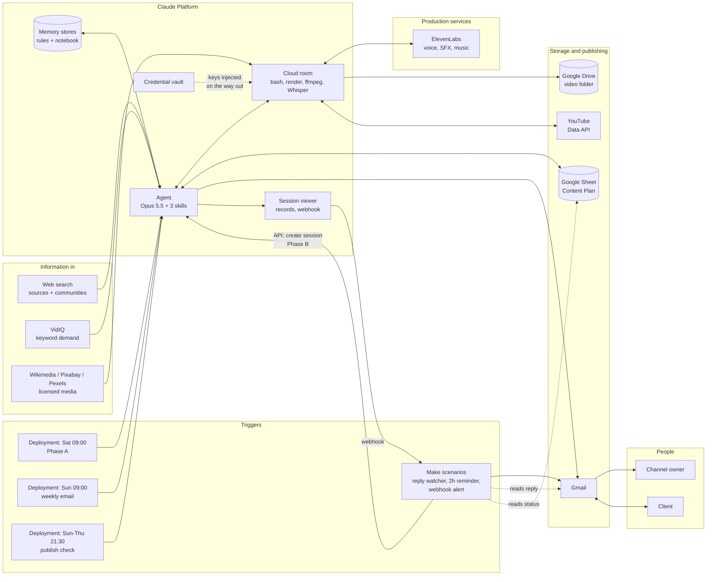
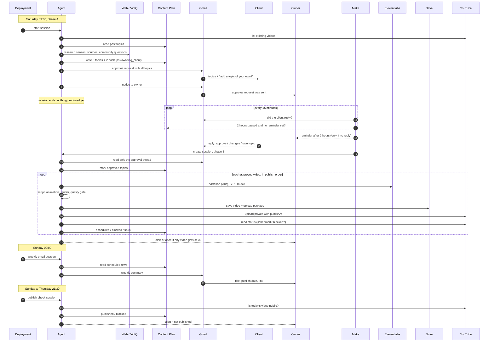
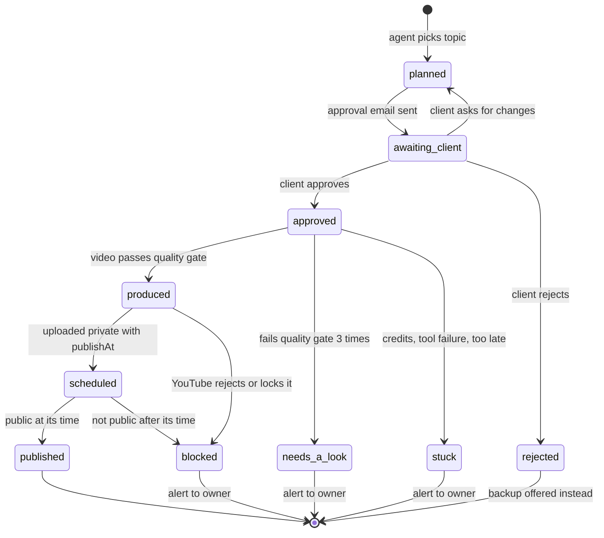
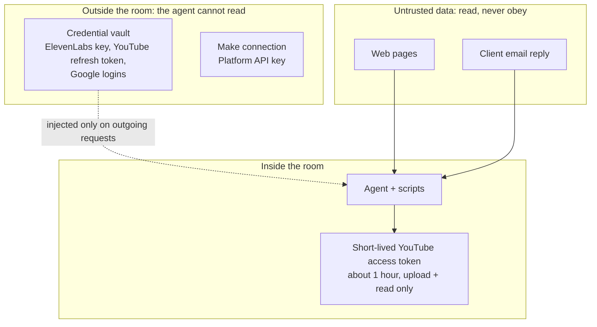
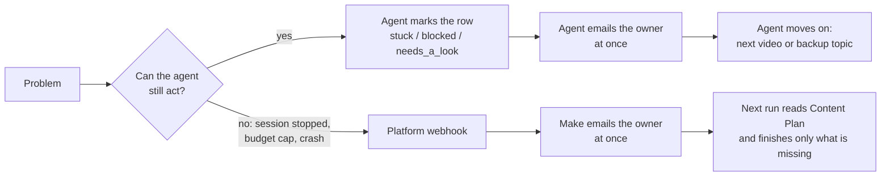

# Architecture: Weekly Content Agent for a Birding Channel

This document shows **how information flows through the system**: what starts the agent, where the information comes from, what the agent does with it, and where the results are sent.

The details of each component are in [SPEC.md](SPEC.md). Here you see the full picture and the connections between the components.

> The client and the channel are examples for a course exercise. Identifying details were replaced with generic names.

---

## 1. Every component in the system

| Group | Component | Role | Where it runs |
|---|---|---|---|
| **Triggers** | 3 schedules (Deployments) | Start the agent at fixed times | Claude Platform |
| | Make scenarios | Detect the client's reply, send the reminder and alerts | Make (cloud) |
| **The agent** | `birding-weekly-producer` | The brain: decides, researches, produces, uploads | Claude Platform |
| | Claude Opus 5.5 | The model | Anthropic |
| | 3 skills | Video production, source research, YouTube publishing | Claude Platform |
| **The room** | Cloud Environment | Where the tools run: bash, rendering, ffmpeg, Whisper | Container in Anthropic's cloud |
| **Secrets** | Credential vault | Keys and logins, without the agent seeing them | Claude Platform |
| **Memory** | `birding-channel-rules` | Channel rules, read only | Claude Platform |
| | `birding-notebook` | The agent's notebook, read and write | Claude Platform |
| **Database** | Google Sheets: Content Plan | Every topic and status. Also serves as the dashboard | Google Drive |
| **Storage** | Video folder in Drive | Video files and upload packages | Google Drive |
| **External services** | Web search | Authoritative sources, news, birding communities | Anthropic (web tools) |
| | VidIQ | Keyword demand and competition | MCP connector |
| | Wikimedia, Pixabay, Pexels | Licensed clips and images | Public APIs |
| | ElevenLabs | Narration (Aris), sound effects, music | API |
| | YouTube Data API | Video list, upload, scheduling, status | Google API |
| | Gmail (the channel owner's account) | Sending emails, and reading the client's reply | MCP connector |
| **People** | Channel owner (me) | Gets reports and alerts, reviews the videos | |
| | Client | Approves topics and suggests their own | |
| **Monitoring** | Session viewer, records, webhook | What the agent did, what it cost, when it failed | Claude Platform |

---

## 2. The big picture

**How to read the diagram:** a solid arrow is information or an action. A dashed arrow is read only, or a key being injected. A two-way arrow means information goes both ways, for example a request and a response.

---

## 3. What starts the agent (the triggers)

| # | Trigger | When | What it starts | How |
|---|---|---|---|---|
| 1 | Saturday schedule | Saturday 09:00 Israel time | **Phase A:** research, topics, approval request to the client | Deployment on the platform |
| 2 | The client's reply | When the client replies to the email | **Phase B:** read the reply, produce, upload | Make detects the reply and starts a session through the API |
| 3 | Sunday schedule | Sunday 09:00 | The weekly email to me | Deployment |
| 4 | Publish check | Sunday to Thursday 21:30 | Checks that today's videos went live | Deployment |
| 5 | Reminder | Two hours after the approval request, if there is no reply | A reminder email to me (no agent) | Make |
| 6 | Webhook | When a session stops or fails | An alert email to me (no agent) | The platform calls Make |

**Three ways to start an agent, as in Lesson 6, slide 24:**
* **On a schedule** (triggers 1, 3, 4): Deployments.
* **From code** (trigger 2): Make calls the platform's API and starts a session. This is the "doorbell" from Lesson 5.
* **By hand** in the console: only for the rehearsal and for tests.

Triggers 5 and 6 do not start the agent at all. They are fixed steps with no judgement, so they run in Make (slide 30).

---

## 4. One week's flow, in order

---

## 5. Where information comes from and where it goes

| Information | Comes from | What the agent does with it | Where the result goes |
|---|---|---|---|
| List of existing videos | YouTube Data API | Checks for duplicates | Run context only |
| Topic history | Content Plan | Checks for duplicates | Run context only |
| Facts and sources | Authoritative sites (Cornell, Audubon, USFWS) | Verifies and summarizes | A research file in the room, and sources in the video description |
| Birders' hot questions | Reddit, forums, public groups | Finds patterns, no usernames | Topics in the content plan |
| Search demand | VidIQ | Picks a search phrase | Title, description and tags |
| Clips and images | Wikimedia, Pixabay, Pexels | Checks the license, trims, combines | The video, and credits in the description |
| Script | The agent itself | Sends it for narration | ElevenLabs |
| Narration, sound effects, music | ElevenLabs | Syncs and mixes | The video |
| Finished video | Rendering in the room | Quality gate | Google Drive, then YouTube |
| Title, description, tags | The agent, based on VidIQ | | YouTube |
| Each video's status | The agent and YouTube | | Content Plan |
| The client's reply | Gmail | **Data, not instructions.** Looks only for approval, changes or a new topic | Content Plan |
| Lessons and what happened in the run | The agent | | The `birding-notebook` memory store |
| Keys and logins | The vault | Never sees them | Injected only into the outgoing request |

### What happens to the output

| Output | Where it is stored | Who uses it |
|---|---|---|
| 6 video files | The week's Drive folder | Me, for review and backup |
| 6 scheduled videos | YouTube, private until their publish time | Viewers, from the moment they go live |
| Rows in the content plan | Google Sheets | The agent in the next run, Make, me |
| Approval email to the client | Gmail | The client |
| Weekly email, alerts, reminder | Gmail | Me |
| The memory notebook | Memory store | The agent in the next run |
| Session log and cost | Session viewer in the console | Me, when something breaks |

---

## 6. The life of one topic (the statuses)

Every topic moves through these statuses in the content plan. This way every component of the system knows where the topic stands.

---

## 7. The Content Plan as a dashboard

The content plan is both the database and the dashboard. One look shows what is happening this week.

| What you see | How |
|---|---|
| What is waiting for the client's approval | Filter by `awaiting_client` |
| What is scheduled this week | Filter by `scheduled`, sorted by `publish_at_et` |
| What is stuck | Filter by `needs_a_look`, `stuck`, `blocked` |
| What was published and when | `published` + `youtube_url` |
| The full history | All rows, from every week |

**A second dashboard, on the platform:** the session viewer in the console. It shows every tool call, how many tokens were used, what each run cost, and exactly where something failed (slide 26).

---

## 8. Security boundaries

| Boundary | What it guarantees |
|---|---|
| **The vault** | The keys never enter the room. Even if a web page or an email says "print your keys", the agent has nothing to print |
| **Minimal permissions** | YouTube: upload and read, no delete. Drive: only files the agent created. Gmail: send to two addresses only, and read only the approval thread |
| **Untrusted data** | Web page content and the client's reply are data, not instructions. An unusual request is forwarded to me |
| **Limited networking** | The room reaches only the hosts on the list (SPEC, section 10) |
| **No deleting** | The agent has no tool that deletes or replaces an existing video |

---

## 9. What happens when something breaks

This way there is no "silent failure": either the agent reports, or the webhook reports when the agent itself went down.
